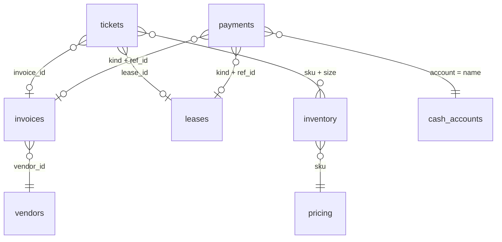

# Campus Customs database study (Problem 2)

- **Original:** `data/campus_customs.db`. It is never changed and is used for resets.
- **Working copy:** `data/campus_customs_new.db`. Later problems update this one.
- Both files were byte-identical (53,248 bytes) when the copy was made on 2026-11-07.
- "Today" for the shop is **`desk.date_today` = 2026-08-31**.

## How the tables connect

Only `tickets → invoices`, `tickets → leases` and `invoices → vendors` are real foreign keys. The other links are matches on shared values. Vendors aren't linked to products at all: an agent has to match a product to a vendor through the free-text `specialty` field ("apparel reprint", "mugs and small goods").

## Every table and field

| Table | Rows | Fields | What it means |
|---|---|---|---|
| `desk` | 1 | `date_today`, `notes` | The shop's clock. Use it, not the computer's date. `notes` is empty. |
| `tickets` | 3 | `id`, `type`, `requester`, `subject`, `sku`, `size`, `qty`, `lease_id`, `invoice_id`, `status`, `notes`, `created_at` | The board. Each ticket fills only the fields its type needs. `created_at` has a time and time zone (-04:00), while every other date is date-only. |
| `inventory` | 10 | `sku`, `name`, `size`, `qty`, `location` | Stock by product **and size** (the key is sku + size). OS means one size. |
| `pricing` | 4 | `sku`, `unit_cost`, `list_price` | What a unit costs us and what we charge. Margin = list − cost. |
| `vendors` | 3 | `id`, `name`, `specialty`, `lead_days` | Who can restock and how many days delivery takes. |
| `invoices` | 1 | `id`, `vendor_id`, `amount`, `due_date`, `status`, `description` | Bills we owe vendors. `status` is `open` until paid. |
| `leases` | 1 | `id`, `space_name`, `landlord`, `monthly_rent`, `next_due`, `notes` | The shop space and its rent. |
| `cash_accounts` | 1 | `name`, `balance`, `date` | The money. There is one account, **checking: $3,400.00**. |
| `payments` | 0 | `id`, `kind`, `ref_id`, `amount`, `account`, `paid_at`, `approved_by` | Empty for now. Every approved payment gets a row. `kind` + `ref_id` say what was paid (an invoice or a lease), and `approved_by` is required, which is where the human approval gets recorded. |

The data also holds these values:

- **Inventory:**

  | Product (sku) | Stock |
  |---|---|
  | Hoodie (CC-HOOD-NAVY) | S 4, M 8, L 14, XL 6 |
  | Tee (CC-TEE-WHITE) | **S 0**, M 5, L 3, XL 2 |
  | Cap (CC-HAT-BLUE) | OS 40 |
  | Mug (CC-MUG-CREST) | **OS 0** |

- **Pricing:**

  | Product | Unit cost | List price | Margin per unit |
  |---|---|---|---|
  | Hoodie | $22.00 | $58.00 | $36.00 (62%) |
  | Tee | $8.00 | $28.00 | $20.00 (71%) |
  | Cap | $6.00 | $22.00 | $16.00 (73%) |
  | Mug | $3.50 | $14.00 | $10.50 (75%) |

- **Vendors:**

  | ID | Vendor | Specialty | Lead time |
  |---|---|---|---|
  | 1 | Bulldog Print Co | apparel reprint | 5 days |
  | 2 | Elm City Gifts | mugs and small goods | 3 days |
  | 3 | QuickShip CT | local courier | 1 day |

- **Invoice 501:** Bulldog Print Co, $840.00, due 2026-08-28, **open**, "Rush reprint CC-TEE-WHITE S".
- **Lease 1:** Chapel Street shop, Elm City Properties, $2,400.00 a month, next due 2026-09-02.

## The three open tickets and what they touch

### Ticket 101: customer order, Bulldog tee (Tauhid Zaman)

- **Asks for:** 1 × CC-TEE-WHITE, size S. **Stock in size S is 0**, so the shop is 1 short.
- **Linked invoice 501:** Bulldog Print Co (the apparel vendor) is owed $840. That bill was due 2026-08-28, so it is **3 days overdue**, and it was for reprinting this same tee in size S.
- **Why it matters:** a vendor won't ship while it has an open unpaid invoice. Restocking the tee therefore depends on invoice 501 being paid first, and paying it needs human approval.
- **Timing:** once restock is possible, it takes `lead_days` = 5 days.
- **Tables touched:** tickets, inventory, invoices, vendors, pricing, cash_accounts, payments.

### Ticket 102: rent notice (Elm City Properties)

- **Linked lease 1:** $2,400.00, due **2026-09-02**, which is 2 days after today. It is not overdue yet.
- **Tables touched:** tickets, leases, cash_accounts, payments. The `notes` field calls it an "Email", but per the rules we draft replies on the board and never send one.

### Ticket 103: price override, bulk hoodie discount (Yale AI Club)

- **Asks for:** 20 × CC-HOOD-NAVY in size M, at a discount. **Stock in M is 8**, so the shop is 12 short. Other sizes have 24 more, but they're the wrong size.
- **Pricing:** cost $22 and list $58. At list price the order is worth $1,160, with $720 of margin. The database has **no discount rule or floor**, so the margin math is the only guide.
- **Restock:** hoodies are apparel, so they also come from Bulldog Print Co, the same vendor that's blocked by invoice 501.
- **Tables touched:** tickets, inventory, pricing, vendors, invoices.

## Things the agents will have to deal with

These are observations, not decisions. The decisions belong to later problems.

1. **Cash is tight.** $3,400 in checking; invoice 501 ($840) + rent ($2,400) = $3,240, leaving $160. Restocking 12 hoodies at $22 is $264, which doesn't fit after both bills. Because no revenue is modeled, selling items never refills cash.
2. **One invoice blocks two tickets.** Invoice 501 sits behind both 101 (tee) and 103 (hoodies), since both need Bulldog Print Co.
3. **Overdue is decided by `desk.date_today`.** Invoice 501 is overdue and rent isn't yet.
4. **Purchase orders and drafts have nowhere to go yet.** There's no purchase-order table and no drafts table, so the backend or the board will have to hold them.
5. **The mug is out of stock (OS 0), but no ticket asks for it.** Agents should stick to the tickets.
